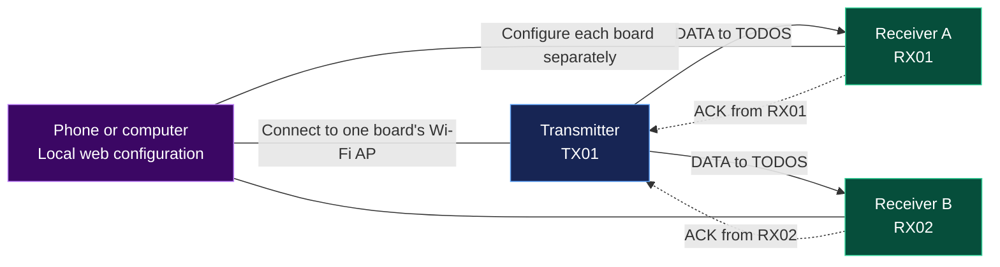
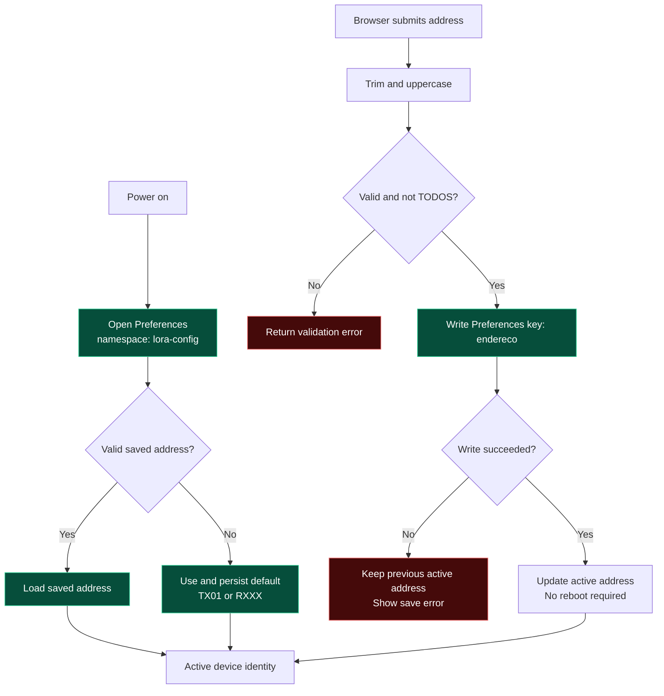
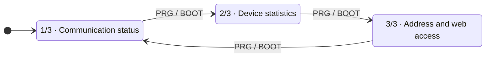
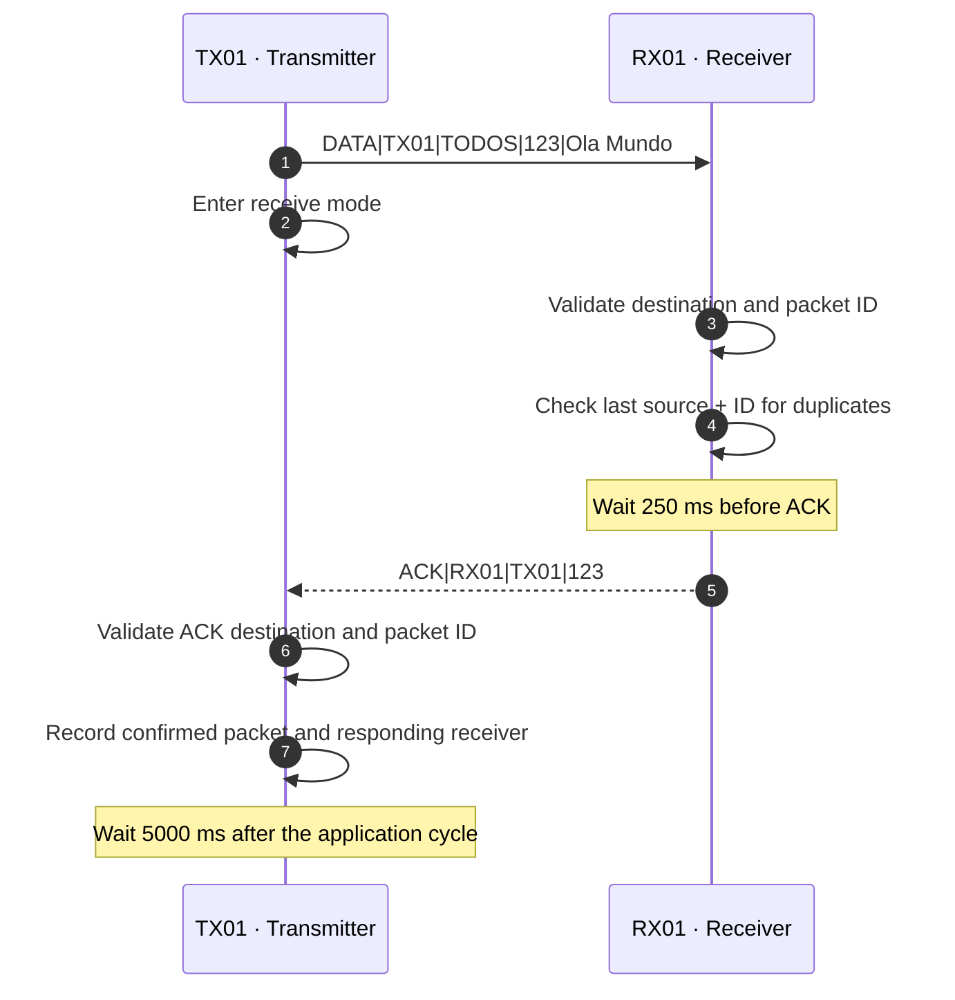
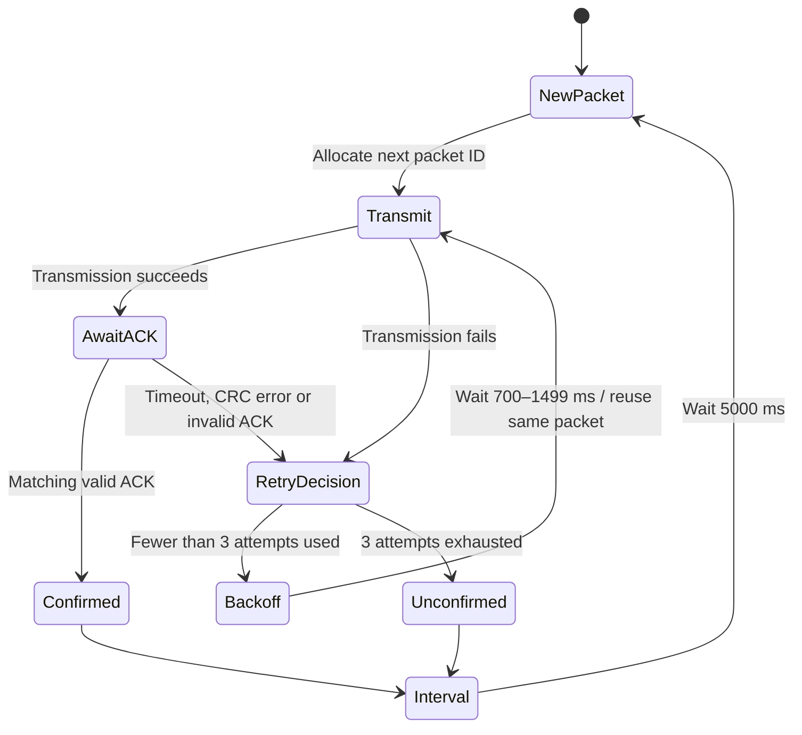
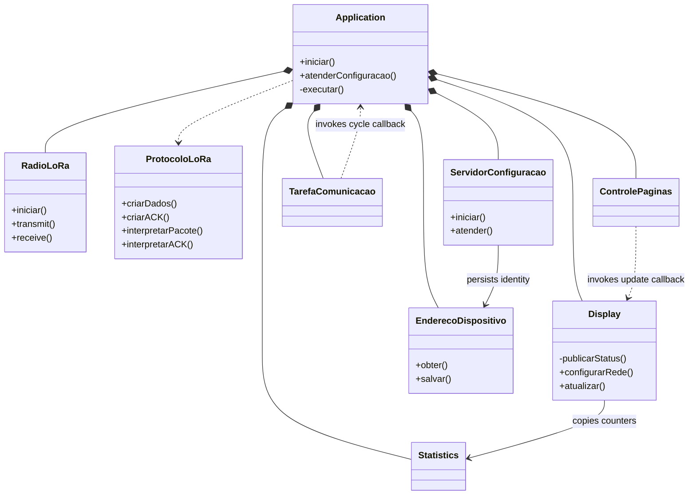
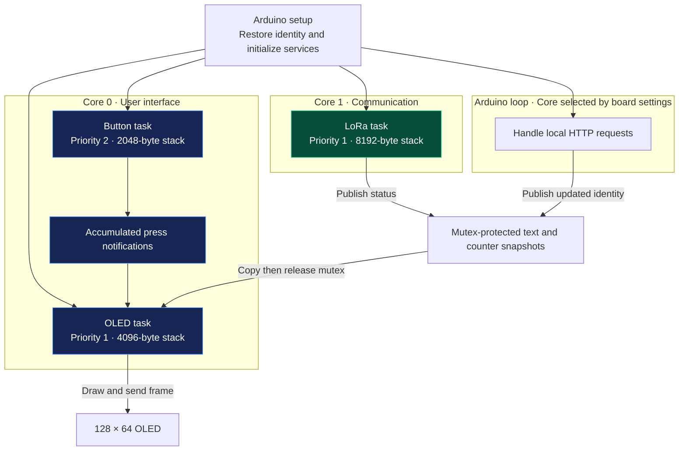
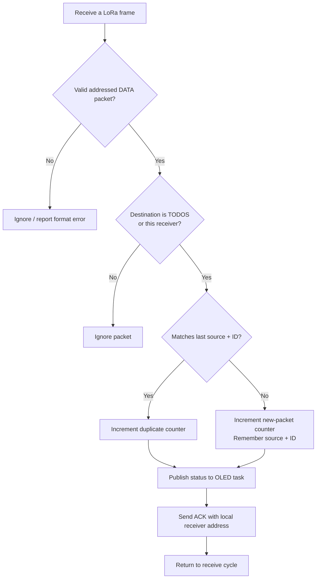

<div align="center">

# ESP32 LoRa Link

### Addressed broadcast · Receiver-aware ACKs · Dual-core firmware

Two object-oriented Arduino applications for the **Heltec WiFi LoRa 32 V3**, with an OLED interface and browser-based device configuration.


[Quick start](#quick-start) · [Web configuration](#web-configuration) · [Protocol](#message-protocol) · [Architecture](#software-architecture) · [Troubleshooting](#diagnostics-and-troubleshooting) · [Changelog](CHANGELOG.md)

</div>

---

## At a glance

| Capability | Implementation |
| :--- | :--- |
| Hardware | Heltec WiFi LoRa 32 V3 with SX1262 and integrated 128 × 64 OLED |
| Communication | Broadcast data with addressed acknowledgments |
| Device identity | `TX01` transmitter default; `RXXX` receiver default |
| Configuration | Local Wi-Fi access point and embedded web page |
| Persistence | ESP32 Preferences, backed by NVS |
| Execution | Button and OLED on core 0; LoRa task on core 1 |
| Navigation | PRG/BOOT cycles through status, statistics, and configuration |
| Delivery policy | First valid ACK confirms the packet |

> [!IMPORTANT]
> **An ACK confirms one receiver, not the entire broadcast group.** Both receivers may receive the same packet, but the transmitter stops retrying after the first valid acknowledgment. Simultaneous receiver ACKs can collide.

## Network overview

One transmitter can broadcast to multiple receivers. Each receiver includes its own configured address in its reply.



The Wi-Fi connection is for local configuration. LoRa carries the application messages and ACKs.

## Quick start

### 1. Prepare the boards

For the example network, use **three Heltec WiFi LoRa 32 V3 boards**: one transmitter and two receivers. Connect the appropriate LoRa antennas before operating the radios.

In Arduino IDE:

1. Install the Espressif ESP32 board package.
2. Select **Heltec WiFi LoRa 32(V3)**.
3. Install **RadioLib** and **U8g2** through Library Manager.
4. Use a serial monitor speed of **115200 baud**.

`WiFi`, `WebServer`, `Preferences`, and FreeRTOS are supplied by the ESP32 Arduino platform.

### 2. Upload the matching sketch

| Board | Sketch | Initial address |
| :--- | :--- | :--- |
| Transmitter | [ESP32LoraTransmissor.ino](ESP32LoraTransmissor/ESP32LoraTransmissor.ino) | `TX01` |
| Receiver A | [ESP32LoraReceptor.ino](ESP32LoraReceptor/ESP32LoraReceptor.ino) | `RXXX` |
| Receiver B | Same receiver sketch | `RXXX` |

Open the `.ino` inside its own directory. Arduino builds the adjacent `.cpp` files automatically.

> [!NOTE]
> Both receivers initially use `RXXX`. Assign distinct addresses, such as `RX01` and `RX02`, through the web page before using them together. A previously saved address takes precedence over the firmware default.

### 3. Configure and run

1. Press PRG/BOOT until OLED page **3/3** appears.
2. Join the board's Wi-Fi network using password **`configlora`**.
3. Open **[http://192.168.4.1](http://192.168.4.1)**.
4. Enter the device address and select **Salvar endereço** (Save address).
5. Observe packet and ACK activity on OLED page 1 or in the serial monitor.

The transmitter sends `Ola Mundo` with a new packet ID on each application cycle. Retries keep the same ID.

## Web configuration

### Connection details

| Setting | Transmitter | Receiver |
| :--- | :--- | :--- |
| Wi-Fi network | `LoRa-TX-XXXXXX` | `LoRa-RX-XXXXXX` |
| Network suffix | Derived from the board's hardware identity | Derived from the board's hardware identity |
| Default Wi-Fi password | `configlora` | `configlora` |
| Configuration URL | `http://192.168.4.1` | `http://192.168.4.1` |
| Default device address | `TX01` | `RXXX` |

Each board creates its own access point. The physical suffix distinguishes networks even when several receivers still have the `RXXX` address. Connect to one board at a time; this Wi-Fi network does not provide internet access.

### Address rules

- Use **1–16 characters**: letters, digits, hyphens, or underscores.
- Leading and trailing whitespace is removed; letters become uppercase.
- `TODOS` is reserved for broadcast and cannot be a device address.
- Give every board a different address.
- Saving applies the address without rebooting. An already-running transmission keeps its original source address through its retries.

### Save and restore lifecycle



| HTTP route | Purpose |
| :--- | :--- |
| `GET /` | Display the current address and configuration form |
| `POST /endereco` | Validate and persist an address; requires the form token |

Persistence uses namespace **`lora-config`** and key **`endereco`**. If storage cannot initialize, the application uses its default address in RAM and reports the issue over serial.

## OLED interface

Press **PRG/BOOT** once to advance. Holding it causes one advance; release it before pressing again. **RST** restarts the board.



| Page | Contents |
| :--- | :--- |
| **1/3 — Status** | Current communication state, received message or ACK details, and errors |
| **2/3 — Statistics** | Packet, acknowledgment, retry, and error counters for the current role |
| **3/3 — Configuration** | Device address, Wi-Fi network, web access IP, and a radio settings summary |

The selected page persists across communication events. All pages are refreshed approximately every **250 ms**, with updates also requested when state or page selection changes.

The button task samples every **10 ms** and applies **40 ms** debounce. Confirmed presses accumulate in task notifications while the OLED task is busy.

## Message protocol

Messages are pipe-delimited text. Field names below describe the format; the actual broadcast value remains **`TODOS`**.

| Message | Format | Example |
| :--- | :--- | :--- |
| Data | `DATA\|source\|destination\|packet_id\|message` | `DATA\|TX01\|TODOS\|123\|Ola Mundo` |
| Acknowledgment | `ACK\|source\|destination\|packet_id` | `ACK\|RX01\|TX01\|123` |

```text
DATA|TX01|TODOS|123|Ola Mundo
     └─┬┘ └─┬─┘ └┬┘ └───┬───┘
     source  all   ID    payload

ACK|RX01|TX01|123
    └─┬┘ └─┬┘ └┬┘
    source  to  confirmed ID
```

The transmitter currently sends to `TODOS`. Receiver parsing also supports a specific destination, accepting a packet only when it targets `TODOS` or the receiver's own address.

An ACK is accepted only when its format is valid, its destination matches the source used for the transmission, and its packet ID matches the pending packet. The receiver address appears in the transmitter's serial output and ACK screen.

### Successful exchange



### Retry behavior



A receiver remembers the **last source address and packet ID** in RAM. A matching retransmission increments the duplicate counter and is acknowledged again. This is a last-packet check, not a persistent history of all previously received messages.

## Software architecture

The firmware uses composition and classes with separate responsibilities. Source identifiers remain in Portuguese; this documentation describes them in English.



`Application`, `Display`, and `Statistics` represent the role-specific `AplicacaoTransmissor` / `AplicacaoReceptor`, `TelaTransmissor` / `TelaReceptor`, and `EstatisticasTransmissor` / `EstatisticasReceptor` classes. `publicarStatus()` is a private display helper.

### Dual-core execution



The LoRa task publishes text and counters rather than drawing into the display buffer. After initialization, the OLED task owns drawing and frame transmission; I²C transfers happen outside the data mutex. The Arduino loop services the web page without duplicating the LoRa application cycle.

### Receiver processing



## Hardware reference

### Pin mapping

Both sketches use the same Heltec V3 pin assignments.

| Component | Signal | ESP32 GPIO |
| :--- | :--- | ---: |
| SX1262 | NSS / chip select | `8` |
| SX1262 | DIO1 | `14` |
| SX1262 | Reset | `12` |
| SX1262 | Busy | `13` |
| OLED | SDA | `17` |
| OLED | SCL | `18` |
| OLED | Reset | `21` |
| OLED power | Vext, enabled with LOW | `36` |
| PRG/BOOT | Page navigation, active LOW | `0` |

The SX1262 module uses the board variant's SPI pin definitions. The OLED uses software I²C through U8g2.

### Radio settings

| Parameter | Value |
| :--- | :--- |
| Frequency | `915.0 MHz` |
| Bandwidth | `125.0 kHz` |
| Spreading factor | `SF9` |
| Coding rate | `4/5` |
| Sync word | `0x12` |
| Transmit power | `20 dBm` |
| Preamble | `8 symbols` |

These values are set in `RadioLoRa::iniciar()` in each sketch. Keep them aligned across all boards.

### Timing and buffer settings

| Parameter | Default | Location |
| :--- | :--- | :--- |
| Maximum attempts per packet | `3` total attempts | TX `Configuracao.h` |
| ACK receive timeout | `3000 ms` | TX `Configuracao.h` |
| Delay between packet cycles | `5000 ms` after the cycle completes | TX `Configuracao.h` |
| Retry backoff | `700–1499 ms` | TX application |
| Receiver wait timeout | `5000 ms` | RX `Configuracao.h` |
| Delay before sending ACK | `250 ms` | RX `Configuracao.h` |
| Data receive buffer | `128 bytes`, one reserved for termination | RX `Configuracao.h` |
| ACK receive buffer | `64 bytes`, one reserved for termination | TX `Configuracao.h` |
| Button debounce | `40 ms` | Both `Configuracao.h` files |
| OLED refresh interval | Approximately `250 ms` | Both display classes |

The transmission interval is not a fixed five-second start-to-start schedule: packet airtime, ACK waits, retries, and backoff add to each cycle.

## Repository layout

```text
ESP32Lora/
├── README.md
├── CHANGELOG.md
├── ESP32LoraTransmissor/
│   ├── ESP32LoraTransmissor.ino
│   ├── AplicacaoTransmissor.h / .cpp
│   ├── TelaTransmissor.h / .cpp
│   ├── EstatisticasTransmissor.h
│   ├── Configuracao.h
│   └── shared-role classes listed below
└── ESP32LoraReceptor/
    ├── ESP32LoraReceptor.ino
    ├── AplicacaoReceptor.h / .cpp
    ├── TelaReceptor.h / .cpp
    ├── EstatisticasReceptor.h
    ├── Configuracao.h
    └── shared-role classes listed below
```

Each sketch contains its own `.h` / `.cpp` copies of:

| Class | Responsibility |
| :--- | :--- |
| `RadioLoRa` | SX1262 ownership, initialization, transmission, and reception |
| `ProtocoloLoRa` | Message encoding and addressed packet parsing |
| `EnderecoDispositivo` | Address validation, synchronized access, and Preferences storage |
| `ServidorConfiguracao` | Wi-Fi AP, embedded page, and HTTP handlers |
| `ControlePaginas` | Independent button and OLED tasks |
| `TarefaComunicacao` | Application cycle pinned to the communication core |

> [!TIP]
> The directories are independent Arduino sketches, not consumers of a shared library. Apply changes to common classes and matching radio parameters in both directories.

## Diagnostics and troubleshooting

| Symptom | What to check |
| :--- | :--- |
| Two receivers appear to have the same identity | Change the default `RXXX` to unique addresses such as `RX01` and `RX02`. |
| No configuration page opens | Join the Wi-Fi AP shown on page 3, then enter `http://192.168.4.1` explicitly. |
| Phone reports “no internet” | The AP is local to the board; keep the connection to configure it. |
| Address changes back after power-off | Check the save result on the web page and serial messages about Preferences. |
| Packets arrive but acknowledgments fail | Match radio settings and firmware protocol versions; inspect IDs, destinations, CRC errors, and possible simultaneous ACKs. |
| Only one receiver is reported | The current transmitter confirms on the first valid ACK; it does not collect every receiver's response. |
| Serial reports page 3 but the OLED stays on page 2 | Use the current display implementation in both sketches; it draws in the OLED task and refreshes every page. Hardware confirmation remains necessary. |
| Radio initialization fails | Read the error code on serial and verify the selected board and hardware connections. |

<details>
<summary><strong>Serial messages worth checking</strong></summary>

The firmware currently uses Portuguese UI and serial labels. Typical diagnostic markers include:

```text
Endereco local: TX01
WiFi de configuracao: LoRa-TX-XXXXXX
Configuracao web: http://192.168.4.1
Receptor que respondeu: RX01
Novo endereco local: RX02
OLED Transmissor - pagina 3/3 - quadro enviado
```

The page message is emitted after the frame-send call returns. It does not independently confirm that the physical display received the frame.

</details>

## Current boundaries and validation

- **Update every board together.** The addressed protocol is incompatible with the earlier `DATA|ID|message` and `ACK|ID` formats.
- **First ACK wins.** Group-wide delivery confirmation and ACK collision avoidance are not implemented.
- **Counters and duplicate tracking are volatile.** The device address is persisted; packet statistics, the transmitter's packet sequence, and the receiver's last-packet record are kept in RAM.
- **Configuration is local.** The embedded page changes the device address; it does not configure a receiver roster, Wi-Fi station credentials, or radio parameters.
- **Validation is user-managed.** Compilation and physical tests of the current firmware are performed by the project owner. The badges describe the stack, not passing CI or verified hardware results.

See [CHANGELOG.md](CHANGELOG.md) for the implementation history. The changelog and firmware UI retain their existing Portuguese text; this README is in English.

---

<div align="center">

**One radio link. Distinct device identities. Configuration that survives a reboot.**

[Back to top](#esp32-lora-link)

</div>
