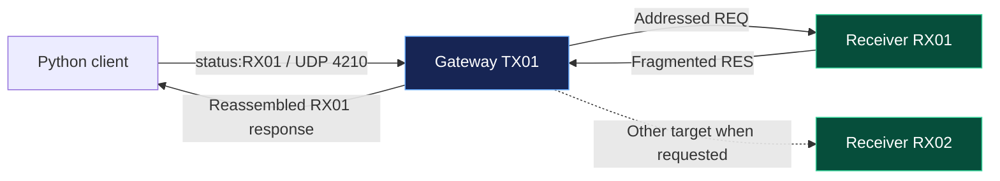
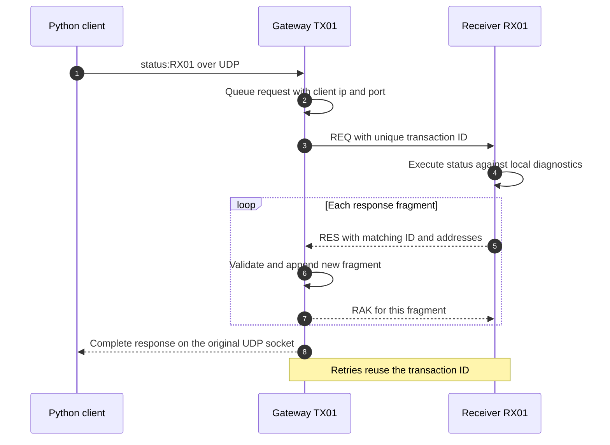
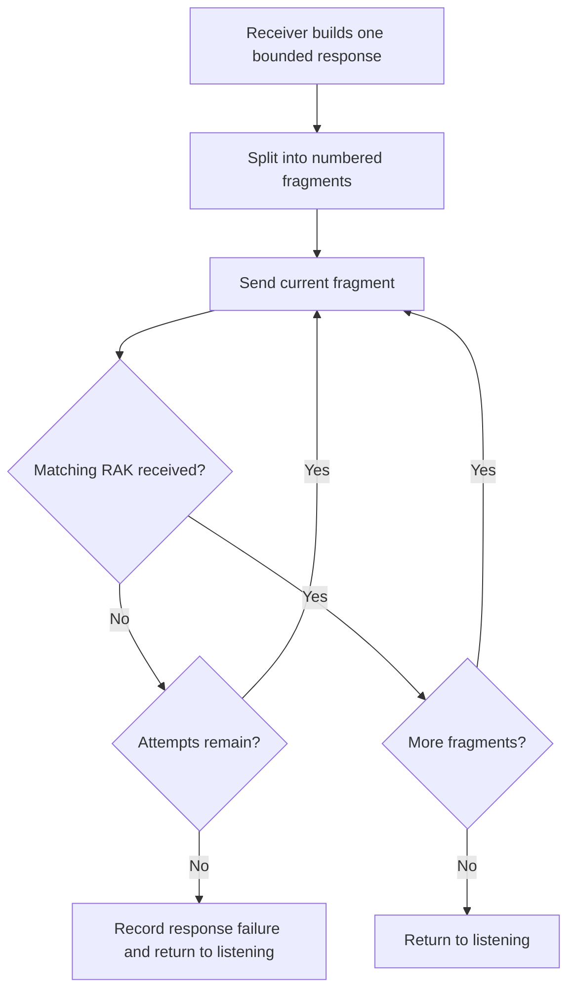
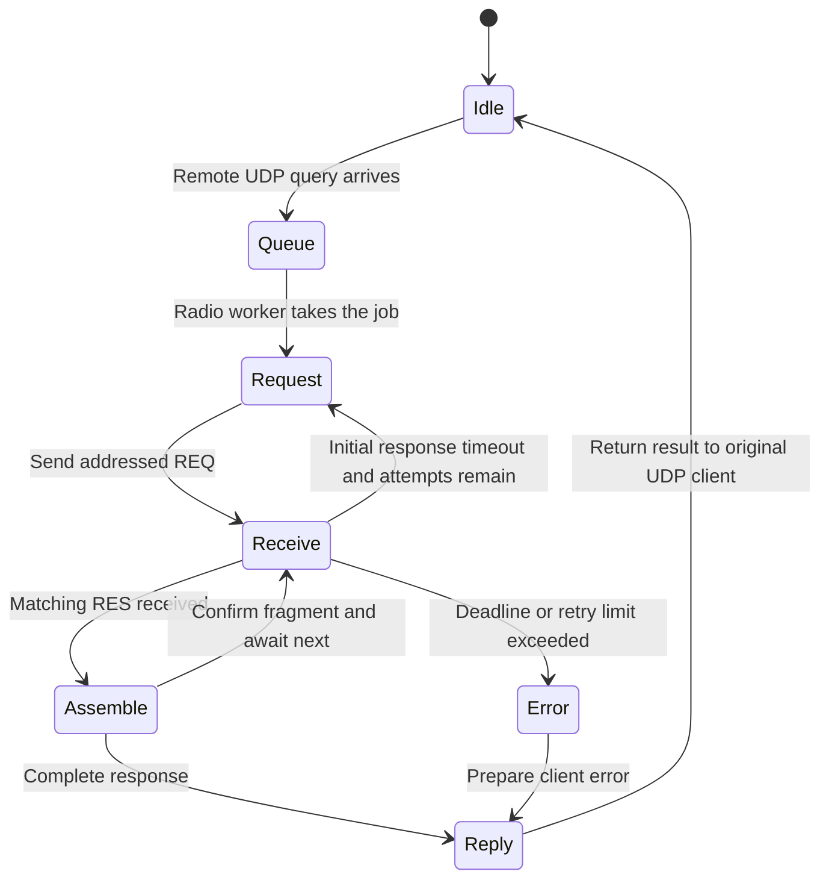
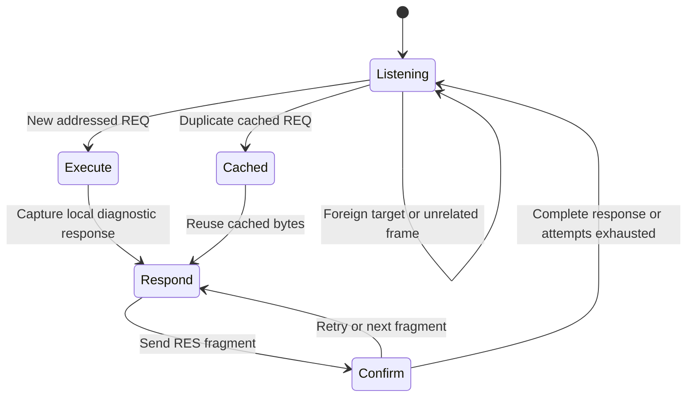
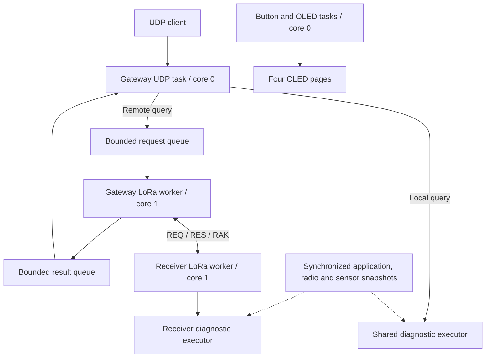
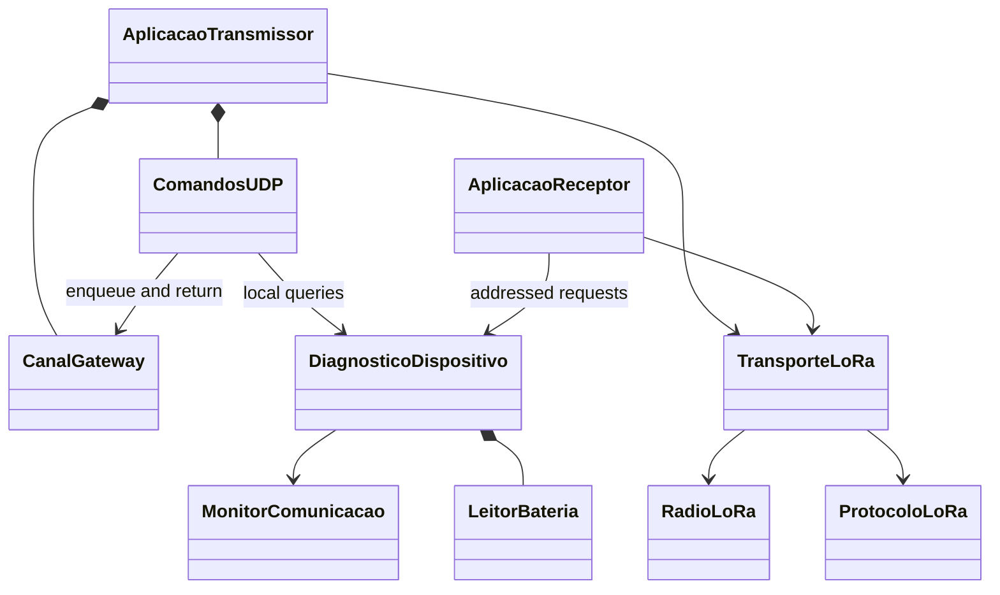
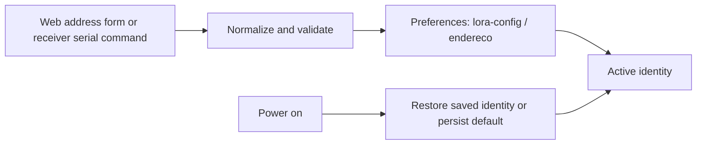

<div align="center">

# ESP32 LoRa Gateway

### Python → UDP → Gateway → LoRa → Receiver → Response

Addressed, on-demand diagnostics for **Heltec WiFi LoRa 32 V3** boards.


[Quick start](#quick-start) · [Commands](#command-routing) · [Protocol](#lora-requestresponse-protocol) · [Architecture](#architecture) · [Wi-Fi](#network-and-device-configuration) · [Command reference](COMANDOS.md) · [Changelog](CHANGELOG.md)

</div>

---

## At a glance

| Role | Behavior |
| :--- | :--- |
| **Gateway — TX01** | Receives UDP queries, answers local diagnostics, or forwards a query to one addressed LoRa receiver. |
| **Receiver — RX01 / RX02** | Listens for addressed requests, executes the shared diagnostics, and returns the result over LoRa. |
| **Python client** | Sends `status:RX01` to the gateway and receives RX01's response on the same UDP socket. |
| **Idle behavior** | No periodic application messages, demo broadcasts, or unsolicited receiver responses over LoRa. |
| **Remote response** | Correlated by request ID and addresses, fragmented and confirmed, then reassembled before UDP delivery. |



The gateway transmits an application request only after a client asks for remote
data. Fragment confirmations and retries belong to that request. Wi-Fi services
and local sensor sampling remain independent of application traffic over LoRa.

## Quick start

### 1. Install the firmware

Use Arduino IDE with the Espressif ESP32 platform, select **Heltec WiFi LoRa
32(V3)**, and install **RadioLib** and **U8g2**. The remaining dependencies are
provided by the ESP32 platform. Attach the appropriate LoRa antennas before use.

| Board | Sketch | Default address |
| :--- | :--- | :--- |
| Gateway | [ESP32LoraTransmissor.ino](ESP32LoraTransmissor/ESP32LoraTransmissor.ino) | `TX01` |
| Receiver A | [ESP32LoraReceptor.ino](ESP32LoraReceptor/ESP32LoraReceptor.ino) | `RXXX` |
| Receiver B | Same receiver sketch | `RXXX` |

Open each `.ino` in its own folder; adjacent `.cpp` files build automatically.
Keep the parent `ESP32Lora` folder and its shared sources beside both sketch
folders. Each sketch's `ComponentesComuns.cpp` includes the parent implementations;
do not copy those implementations into the sketch or compile them a second time.

> [!IMPORTANT]
> **Update the gateway and every receiver together.** The new `REQ` / `RES` / `RAK`
> protocol replaces the previous demo's `DATA` / `ACK` format. Old firmware is not
> compatible. Existing addresses and Wi-Fi settings remain in Preferences.

### 2. Give each receiver a unique address

Connect each receiver by USB, open a **115200-baud** serial monitor, and select
**Newline** or **Both NL & CR**. Configure one board at a time:

```text
endereco RX01
endereco?
```

Use `endereco RX02` on the second receiver. `ajuda` prints serial help. These
changes apply without a reboot and persist after power-off. The receiver's local
web page can also change its address.

### 3. Connect the gateway to Wi-Fi

Join its `LoRa-TX-XXXXXX` access point with password **`configlora`** and open
**[http://192.168.4.1/config](http://192.168.4.1/config)**. Save your router SSID and
password. Once connected, **OLED page 3/4** shows the router SSID and gateway's
actual IP address. Put the Python computer on the same network.

### 4. Query a receiver

Replace the example IP with the gateway IP shown on its OLED:

```sh
python tools/udp_query.py 192.168.1.50 status:RX01
python tools/udp_query.py 192.168.1.50 temp:RX01 ram:RX01 flash:RX02
python tools/udp_query.py 192.168.1.50 battery:RX01 status_json:RX02
```

The [Python client](tools/udp_query.py) requires only the standard library. It
waits **75 seconds for remote queries**, or **3 seconds for local queries**, unless
`--timeout` is supplied. Large LoRa responses take several seconds.

## OLED screensaver

The four information pages share icon headers, highlighted page numbers,
aligned counters, and scrolling text for long titles, network names, and status
messages. Radio settings and OTA progress remain available.

Both boards show animated robot faces after **5 minutes of inactivity**.
A button press wakes the display without changing the selected page. Incoming
UDP commands on the gateway, addressed LoRa requests on a receiver, and receiver
serial commands also wake it and restart the timer. Background status refreshes
do not restart it; OTA progress takes priority. Communication stays active.

## Command routing

Send one ASCII command per UDP datagram to the **gateway**, port **4210**.
Commands and addresses are case-insensitive; surrounding spaces are ignored.
Command names, help output, and examples use lowercase. Device addresses,
LoRa frame markers, and response field names retain their existing format.

| Request sent to gateway | Executed on |
| :--- | :--- |
| `status` | Gateway itself |
| `status:TX01` | Gateway itself, if its current address is TX01 |
| `status:RX01` | Receiver RX01, through LoRa |
| `status_json:RX02` | Receiver RX02; reassembled JSON returned to the client |
| `name:RX01` | Receiver RX01; returns its configured address |

A receiver responds only to its exact address. Broadcast targets are not accepted
for queries. IDs such as `RXXX` must be unique before multiple receivers are used.

| Query | Information available on both roles |
| :--- | :--- |
| `help` | Command list starting with `COMANDOS` |
| `name` / `alive` | Configured address / liveness |
| `info` / `status` | Summary of the queried device |
| `status_json` / `info_json` | Structured summary |
| `temp` / `cpu` | Internal CPU temperature, model, revision, cores, and clock |
| `ram` / `heap` | Heap total, free, minimum, largest block, and PSRAM |
| `flash` | Physical capacity, firmware size, active partition, and OTA slot size |
| `net_info` / `ip` / `mac` / `rssi` | Queried device's Wi-Fi information |
| `radio` / `radio_status` | Tracked driver mode, result code, settings, and latest receive metrics |
| `counters` | Transactions, requests, responses, fragments, retries, and errors |
| `battery` / `vbat` | Queried board's estimated VBAT voltage and sample age |
| `ota_status` | Update support, state, and progress |
| `udp_status` | Local listener status; receivers report that they use LoRa via the gateway |
| `build` / `version` / `reason` / `uptime` | Role-specific build, reset cause, and uptime |

The executor is shared by both sketches. Unsupported hardware or services are
reported honestly: receiver firmware does not run an OTA server or a UDP listener,
so its status commands report those capabilities as unavailable. `flash` still
reports the receiver's actual physical memory and available application slot.

See [COMANDOS.md](COMANDOS.md) for command details and response interpretation.
All network commands are queries; they do not change settings or reboot a board.

## LoRa request/response protocol

| Frame | Format |
| :--- | :--- |
| Request | `REQ\|gateway\|receiver\|id\|command` |
| Response fragment | `RES\|receiver\|gateway\|id\|part\|total\|payload` |
| Fragment confirmation | `RAK\|gateway\|receiver\|id\|part` |

For example:

```text
REQ|TX01|RX01|123|status
RES|RX01|TX01|123|1|1|<response payload>
RAK|TX01|RX01|123|1
```



### Fragmentation and retries

A response can contain up to **1400 bytes**. It is split into **160-byte payloads**,
with at most **nine fragments**, keeping every complete LoRa frame within the
SX1262's 255-byte limit. UTF-8 data is reassembled as bytes before UDP delivery.



The gateway checks source, destination, transaction ID, fragment count, order, and
payload limits. Duplicate fragments are acknowledged without appending their bytes
again. The receiver caches its last request and response, so retrying the same
request does not execute it again or mix readings from different snapshots.

A short completion window lets the gateway repeat the last fragment confirmation
if needed. Each UDP request retains its own client IP and source port; a late
response from a different transaction is ignored.

### Gateway lifecycle



### Receiver lifecycle



## Architecture

### Core and task ownership



Only the LoRa worker in each sketch calls the SX1262 driver. The UDP task queues
remote jobs and returns completed responses; it never accesses SPI concurrently.
The receiver's Arduino loop maintains serial configuration, its web page, and the
sensor cache. The gateway's UDP task maintains its local diagnostic sensor cache.

Button and OLED tasks remain independent. The gateway retains its web and
ArduinoOTA services; both use synchronized update snapshots for diagnostics.

### Classes and responsibilities



| Component | Responsibility |
| :--- | :--- |
| `CanalGateway` | Four-entry request/result queues and client correlation |
| `ComandosUDP` | UDP transport, local/remote routing, and delivery back to clients |
| `DiagnosticoDispositivo` | Shared command catalog and device-local diagnostics |
| `ProtocoloLoRa` | Bounded addressed RPC frame encoding and parsing |
| `TransporteLoRa` | Frame transmission/reception, exclusively from the radio worker |
| `MonitorComunicacao` | Cross-core snapshots of transaction state and counters |
| `RadioLoRa` | SX1262 ownership and tracked driver operation state |
| `LeitorBateria` | Nonblocking ADC settling and averaged battery samples |
| `EnderecoDispositivo` | Validated device address and NVS persistence |
| `ServidorConfiguracao` | Role-specific HTTP configuration and gateway network services |

### Shared source organization

Common code lives directly in the parent `ESP32Lora` folder, alongside
[LayoutTela.h](LayoutTela.h) and [ProtecaoTela.h](ProtecaoTela.h):

| Shared files | Responsibility |
| :--- | :--- |
| [ConfiguracaoComum.h](ConfiguracaoComum.h) | Heltec pinout, radio settings, RPC limits, battery timing, and task cores |
| [ControlePaginas.h](ControlePaginas.h) / [cpp](ControlePaginas.cpp) | Button debounce and OLED task |
| [EnderecoDispositivo.h](EnderecoDispositivo.h) / [cpp](EnderecoDispositivo.cpp) | Address validation and NVS; each application supplies its own default address |
| [RadioLoRa.h](RadioLoRa.h) / [cpp](RadioLoRa.cpp) | SX1262 driver and synchronized radio state |
| [ProtocoloLoRa.h](ProtocoloLoRa.h) / [cpp](ProtocoloLoRa.cpp) | REQ, RES, and RAK encoding and parsing |
| [TransporteLoRa.h](TransporteLoRa.h) / [cpp](TransporteLoRa.cpp) | LoRa frame transport |
| [TarefaComunicacao.h](TarefaComunicacao.h) / [cpp](TarefaComunicacao.cpp) | Radio worker task |
| [LeitorBateria.h](LeitorBateria.h) / [cpp](LeitorBateria.cpp) | Nonblocking battery sampling |
| [MonitorComunicacao.h](MonitorComunicacao.h), [EstatisticasComunicacao.h](EstatisticasComunicacao.h), [EstadoOTA.h](EstadoOTA.h) | Shared snapshots and counters |
| [DiagnosticoDispositivo.h](DiagnosticoDispositivo.h) / [cpp](DiagnosticoDispositivo.cpp) | Common diagnostic interface, sensor cache, JSON escaping, and network/OTA helpers |

Sketch headers reference shared headers through `../`. Arduino compiles each
sketch's `ComponentesComuns.cpp`, which includes the shared implementations once.
Changes to a shared source apply to both firmwares.

Each sketch retains its application, display data, command transport, web services,
and `Configuracao.h` with role-specific project name, default address, and OTA
settings. The local `DiagnosticoDispositivo.cpp` files retain role-specific response
formatting, including existing field capitalization and service availability.
Do not move or distribute a sketch folder without its parent shared sources.

## Network and device configuration

| Setting | Gateway | Receiver |
| :--- | :--- | :--- |
| Device address default | `TX01` | `RXXX` |
| AP SSID | `LoRa-TX-XXXXXX` | `LoRa-RX-XXXXXX` |
| Default AP password | `configlora` | `configlora` |
| Local web access | `http://192.168.4.1` | `http://192.168.4.1` |
| Router connection | Up to five saved Wi-Fi networks | Not implemented |
| UDP commands | Port 4210 | Through gateway over LoRa |
| Firmware OTA | Browser and Arduino IDE | Not implemented |

The AP password must be empty for an open network, or 8–63 characters for a
password-protected network. A compile-time check rejects invalid lengths.

Device addresses accept 1–16 letters, digits, hyphens, or underscores. They are
normalized to uppercase, and `TODOS` is reserved. The gateway uses a captured
source address during a transaction; an address change applies to later requests.



### Gateway Wi-Fi and IP

The M5NanoC6-inspired form at `/config` stores up to five networks in Preferences
namespace **`lora-wifi`**, key **`redes`**. An empty SSID removes a slot; an empty
password preserves the previous password only if that SSID is unchanged. The
**Rede aberta** option explicitly clears a password. Saved passwords are not
returned to clients.

The manager tries saved slots in order with a 13-second timeout per attempt.
Searches for nearby networks are asynchronous. AP + STA mode retains local
configuration while a router connection is attempted, although shared Wi-Fi
channel changes can briefly interrupt an AP client's connection.

When connected to a router, page **3/4** shows its **SSID and the gateway's DHCP
IP**. Open `http://<ip-shown>/config` or `/ota` from the same network. Without that
connection, the OLED shows local AP information instead. The web server listens
on port 80 across the available Wi-Fi interfaces.

## OLED pages

PRG/BOOT cycles **1 → 2 → 3 → 4 → 1**. Holding the button advances once; release it
before pressing again. RST restarts the board.

| Page | Contents |
| :--- | :--- |
| **1 — Status** | Gateway query progress or receiver request/response status |
| **2 — Statistics** | Role-specific request/response counters and errors |
| **3 — Network** | Device identity, SSID, IP, and connection information |
| **4 — Radio** | Frequency, bandwidth, SF, coding rate, sync word, power, preamble |

All pages refresh periodically. The button uses 40 ms debounce and a separate
sampling task. During gateway OTA, a temporary overlay shows percentage, a progress
bar, and update state; 100% is displayed after successful firmware validation.

## Gateway firmware OTA

Both update methods remain available **without a password or login screen**:

- **Browser:** open `http://<gateway-ip>/ota` and upload
  `ESP32LoraTransmissor.ino.bin`.
- **Arduino IDE:** after installing this firmware and connecting gateway and
  computer to the same network, select **LoRa-TX01** under **Tools → Port**.
  ArduinoOTA uses port **3232** and mDNS discovery.

A firmware version without ArduinoOTA must be updated once by USB or the existing
browser updater before the IDE can discover it. Local mDNS and upload traffic must
be allowed by the computer and network; guest-client isolation can prevent access.

The updater requires a distinct inactive OTA application slot. The installed
Heltec V3 `default_8MB` layout has two `0x330000`-byte application slots. If the
running board has no OTA-capable layout, install one by USB first. Upload only the
application binary, never bootloader, partitions, merged images, or receiver firmware.

HTTP upload checks size, ESP32-S3 application headers, and the application
descriptor. Platform image validation precedes boot selection. Both transports
share `Update` and are serviced separately. After success, the board restarts
after approximately two seconds. This does not provide automatic recovery from
application-level bugs after a successful boot. Addresses and Wi-Fi settings
remain in separate Preferences namespaces.

OTA, resets, Flash operations, packet loss, and radio congestion can interrupt
remote queries; retry from the client after the device is ready.

## Hardware and timing reference

| Signal | GPIO |
| :--- | ---: |
| SX1262 NSS / DIO1 / Reset / Busy | `8 / 14 / 12 / 13` |
| OLED SDA / SCL / Reset / Vext | `17 / 18 / 21 / 36` |
| PRG/BOOT | `0` |
| Battery ADC / measurement enable | `1 / 37` |

| Radio parameter | Default |
| :--- | :--- |
| Frequency / bandwidth | `915.0 MHz / 125.0 kHz` |
| Spreading factor / coding rate | `SF9 / 4/5` |
| Sync word / transmit power / preamble | `0x12 / 20 dBm / 8 symbols` |

| RPC parameter | Default |
| :--- | :--- |
| Maximum request command | `128 bytes` |
| Maximum response | `1400 bytes` |
| Fragment payload / maximum fragments | `160 bytes / 9` |
| End-to-end job deadline, including queue wait | `60000 ms` |
| Initial request attempts | `3` |
| Initial response wait | `5000 ms` |
| Fragment confirmation wait / attempts | `2500 ms / 3` |
| Radio turnaround pause | `120 ms` |
| Request / result queue capacity | `4 / 4` |
| Maximum UDP input / output | `255 bytes / 1400 bytes` |

These are defaults in `Configuracao.h`. Radio settings must match on all boards.
The maximum LoRa frame is 255 bytes including the RPC header. Old demo interval
constants, if present, do not schedule any transmissions in the gateway workflow.

### Measurement interpretation

RAM values describe allocator-managed heap, not all physical SRAM. Flash capacity
is not filesystem free space. CPU temperature comes from the internal sensor,
not an ambient sensor. Radio mode tracks driver operations rather than performing
concurrent register probes. Component snapshots are individually synchronized,
not one atomic board-wide measurement.

Battery conversion uses the Heltec V3's nominal divider as described in the
[official manual](https://s.heltec.cn/download/WiFi_LoRa_32_V3/HTIT-WB32LA_V3%28Rev1.1%29.pdf)
and [V3.1 schematic](https://s.heltec.cn/download/WiFi_LoRa_32_V3/HTIT-WB32LA%28F%29_V3.1_Schematic_Diagram.pdf).
Readings are averaged and expose their sample age. Verify with a multimeter and
adjust `CALIBRACAO_BATERIA` if needed. Voltage does not establish battery presence,
charge percentage, charger state, or USB power source. Unavailable values are
reported as `N/D` or JSON `null`.

## Troubleshooting and validation

| Symptom | Check |
| :--- | :--- |
| `status:RX01` times out | Matching RPC firmware, receiver address, power, radio settings, and range. |
| Two receivers answer unpredictably | Configure unique IDs before using both; no broadcast query target is supported. |
| Gateway responds locally but not remotely | Inspect `radio` and `counters`; remote jobs require the LoRa worker to be ready. |
| Gateway reports queue full | Retry later; one LoRa transaction runs at a time. |
| Remote JSON query expires in a custom client | Allow for fragmentation and retry latency; use a timeout longer than the gateway's 60-second job deadline. |
| Receiver `udp_status` or `ota_status` reports unavailable | Expected: receivers execute diagnostics through LoRa; those network services run only on the gateway. |
| AP visible but web page unavailable | Read startup errors; invalid AP passwords prevent server initialization. |
| IDE does not discover OTA | Install ArduinoOTA-enabled firmware, verify same LAN, mDNS and firewall settings. |

Compilation and physical firmware/radio/battery tests are **user-managed**. Badges
describe implemented components, not passing CI or validated hardware performance.
The command catalog, UI, and changelog retain Portuguese text; this README is English.

---

<div align="center">

**Ask the gateway. Measure the receiver. Return the actual response.**

[Back to top](#esp32-lora-gateway)

</div>
